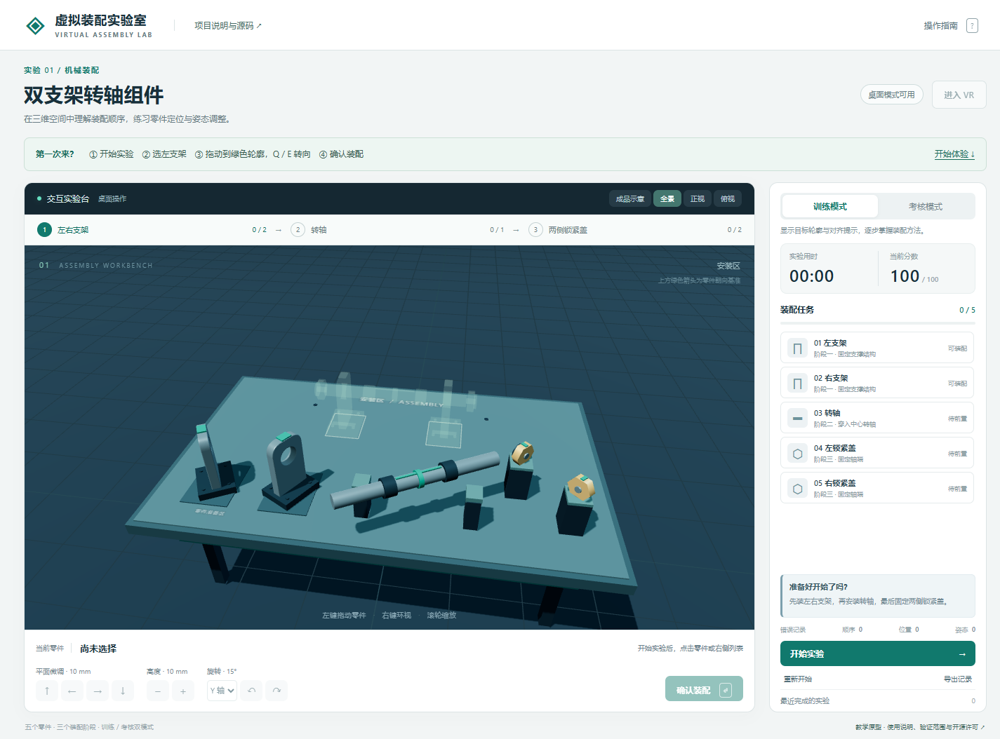

# Assembly Training Lab · 虚拟装配实验室

在浏览器中装好两个支架、一根转轴和两侧锁紧盖，观察**工序、位置与姿态**如何共同决定一次装配是否成功。

一个从课程需求整理出来的小型教学原型。电脑浏览器即可使用；WebXR入口为实验性功能。

[在线体验](https://th0rgoodman.github.io/assembly-training-lab/) · [项目说明](https://th0rgoodman.github.io/assembly-training-lab/about.html) · [运行与操作](docs/usage.md) · [设计与验证](docs/design.md) · [开发来源](docs/provenance.md)



## 能做什么

- 三维零件选择、拖动、旋转、视角切换与容差吸附。
- 训练模式提供目标轮廓和偏差；考核模式隐藏辅助提示。
- 五件装配、三个阶段，支持同阶段零件交换先后。
- 错误反馈、冻结完成用时、JSON导出与最近五次本机记录。
- 独立规则模块及自动测试，附控制器抓取与释放逻辑。

没有账户、付费API或远程模型依赖。Three.js已随项目提供，下载后可离线本地运行。

## 本地运行

安装[Node.js](https://nodejs.org/) 22或更新版本，在本目录执行：

```sh
node scripts/serve.mjs
```

打开终端显示的 `http://127.0.0.1:8766/`。不用执行依赖安装；不要直接双击HTML。服务只监听本机，按Ctrl+C停止。端口占用时可设置环境变量 `PORT`。

```sh
node --test
node scripts/build.mjs
```

构建输出为 `dist/`，可部署到静态托管平台。构建文件按明确清单复制，测试、开发脚本和Git目录不进入站点。

如果安装了npm，也可以使用 `npm start`、`npm test` 和 `npm run build`，无须 `npm install`。

## 第一次操作

1. 开始训练，选择“左支架”。
2. 拖近目标轮廓，用方向按钮或W/A/S/D微调；Q/E绕所选轴每次旋转15°。
3. 工序、位置、姿态均符合时，点击“确认装配”。再依次完成另一支架、转轴和两侧锁紧盖。

R/F调整高度；按住Shift时平移步长由10毫米变为50毫米。可通过“成品示意”观察结构，该功能不会产生完成成绩。

## 验证范围与限制

- 29项自动测试：28项装配规则／合成控制器测试，1项本地服务访问边界测试。
- 发布准备期间在Chromium中核验训练流程、错误提示、完成结果、JSON内容、重置、考核提示隐藏和本机历史清除。
- 真实头显、手感、舒适度和学习效果**未测试**；移动端检查不等于所有手机兼容性保证。
- 这是几何与规则原型，没有刚体碰撞、接触力或真实螺纹仿真。55毫米吸附阈值是交互教学设置，不是机械加工公差。
- 当前界面主要为中文。训练分数反映预设规则下的操作，不是标准化技能测评。

测试的具体方式、日期和边界见[设计与验证](docs/design.md)。

## 数据与来源

应用只在当前浏览器保存最近五次完成记录，可清除或导出；没有应用分析埋点。托管平台仍可能保留普通访问日志。

开发与文档使用了AI辅助，公开版本不声称作者独立完成全部代码、已开展真人教学实验或头显实测。实际已确认的需求、自动检查与未验证部分在[开发来源](docs/provenance.md)中分开说明。

自有代码与文档采用[MIT](LICENSE)许可，允许包括商业用途在内的复用，需保留许可与版权声明。Three.js r169的原许可见[第三方说明](THIRD_PARTY_NOTICES.md)。

## English summary

A small, browser-based mechanical assembly teaching prototype. Assemble two supports, a shaft and two end caps while exploring sequence, position and orientation constraints. Includes training/assessment modes, JSON export and experimental WebXR input.

Run `node scripts/serve.mjs` with Node.js 22+, then open the local URL. No dependency installation is required. Run `node --test` for automated checks and `node scripts/build.mjs` for static deployment output. The interface is currently in Chinese; a headset is not required for desktop use. Physics, headset performance and learning outcomes are not validated.
